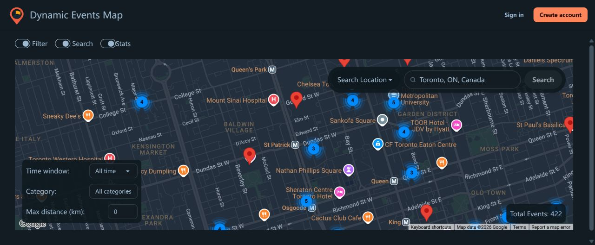

# Dynamic Event Map

Discover Toronto events on an interactive map. Browse by location, category and date, save activities, and share local discoveries.

[Open the live map](https://www.dynamic-event-map.cloud)



## Features

- Google Maps with clustered event markers, location search and filters.
- Official City of Toronto event data alongside community submissions.
- Google sign-in and email/password registration with verification and password reset.
- Bookmarks, comments and ownership-controlled event editing.
- Recommendations with explanations and optional personalization based on saved categories.
- Independent opt-in settings for event reminders and weekly discovery emails, with signed unsubscribe links.
- Live updates through Socket.IO and Redis.

Email delivery is currently disabled. Preferences and recommendations work independently of sending mail.

## Stack

| Layer | Technology |
| --- | --- |
| Client | React, Vite, Tailwind CSS, Google Maps and Places |
| API | Node.js, Express, Socket.IO |
| Data | PostgreSQL 16, Redis 7 |
| Authentication | Firebase Authentication |
| Containers | Docker Compose for development; Docker Swarm for production |
| HTTPS | Traefik, Nginx, Let's Encrypt |
| Hosting | AWS Lightsail in Canada (Central) |
| Backups | Private Amazon S3 with checksum-verified recovery |
| Releases | GitHub Actions and GitHub Container Registry |
| Email | Amazon SES, signed SNS feedback and a PostgreSQL outbox |

The deployment uses one VM. Container replicas do not provide host-level high availability.

## Development

Install Docker with Compose and Node.js 22.12 or later. Shell examples use Bash; use Linux, macOS or WSL.

1. Copy `.env.example` to `.env` and configure the browser values. Give the local database a unique password.
2. In Firebase, enable Google and email/password sign-in and authorize `localhost`. Set matching `FIREBASE_PROJECT_ID` and `VITE_FIREBASE_PROJECT_ID` values.
3. Enable Maps JavaScript API and Places API (New). Use a separate development browser key restricted to the development website and these APIs. Browser Firebase/Maps configuration is public in the compiled client; it must not contain a server credential.
4. Start the services:

   ```sh
   docker compose -f docker-compose.dev.yml config --quiet
   docker compose -f docker-compose.dev.yml up --build -d --wait
   ```

5. Apply both migrations to the development database:

   ```sh
   for migration in db/migrations/001_ingestion_identity.sql db/migrations/002_notifications.sql; do
     docker compose -f docker-compose.dev.yml exec -T db sh -ec \
       'exec psql -X -v ON_ERROR_STOP=1 -U "$POSTGRES_USER" -d "$POSTGRES_DB"' < "$migration"
   done
   ```

Open `http://localhost:3000`; the API is available at `http://localhost:5000/api`. Development database/cache ports bind to loopback. Do not use `docker compose down -v` to update a database you want to keep.

The API validates Firebase ID tokens with public signing certificates and the configured project ID. Web login requires no Firebase service-account private key. Administrative user lookups and revocation checks require separate credentials; the optional mail worker uses a dedicated read-only identity.

### Import event data

The importer reads the City's [Festivals & Events dataset](https://open.toronto.ca/dataset/festivals-events/). No Toronto API key is required. It validates the complete official snapshot, normalizes Toronto dates, deduplicates source identities, and imports non-ended event series with individual occurrence starts.

```sh
npm ci --prefix infra/ingest
mkdir -p .local
# Preview only; no database writes.
node --env-file=.env infra/ingest/update_toronto_events.js --output .local/import-preview.json
# Review the preview, then import into the local Compose database.
DB_HOST=127.0.0.1 REDIS_HOST=127.0.0.1 \
  node --env-file=.env infra/ingest/update_toronto_events.js --write
```

A fresh database starts without downloaded events. Imports preserve internal events and manual edits, and use a transaction and advisory lock. A failed, partial or stale download does not replace existing data. Missing source entries are not automatically deleted or declared cancelled. Recurring event ranges are not treated as continuous opening hours.

The feed is large: allow at least 400 MiB of free disk for its temporary snapshot. Production ingestion uses a 768 MiB container limit and a 512 MiB Node heap. Do not put its staging directory on tmpfs. Legacy external rows require a reviewed source-ID mapping before importing; do not delete them to bypass that guard.

### Checks

```sh
npm ci --prefix api
npm ci --prefix client
npm test --prefix api
npm test --prefix client
npm test --prefix infra/ingest
npm run build --prefix client
```

Database and Redis integration tests are opt-in and should target isolated test resources.

## Production setup

### Host and accounts

1. Create an Ubuntu 24.04 x86-64 Lightsail instance and static IP. Point the apex and `www` DNS records to it. Allow public TCP 80/443; restrict SSH to operator addresses. Keep PostgreSQL, Redis, Docker and Swarm management ports private.
2. Configure production Firebase authorized domains and a production Maps key restricted to the actual website and required APIs. Configure quotas and billing alerts in the provider consoles.
3. Create a private regional S3 bucket with Block Public Access, Bucket owner enforced and SSE-S3. Choose lifecycle retention explicitly, including noncurrent versions and incomplete multipart uploads when versioning is enabled.
4. Give a dedicated backup identity `s3:PutObject`, `s3:GetObject`, `s3:AbortMultipartUpload` and `s3:ListMultipartUploadParts` on the chosen object prefix, and `s3:ListBucket` constrained to that prefix. It needs no object deletion, bucket creation or IAM administration permissions. Read access is required for full backup verification and restores.
5. Use a dedicated SSH key and verify the server fingerprint through the provider console. The deployment user needs noninteractive `sudo`; this key therefore grants host administration and must be protected accordingly.

Upload only `stack.yml`, `stack.notifications.yml`, `stack.notifications.identity.yml`, `db/`, `infra/scripts/`, `infra/system/` and `infra/env/.env.production.example` into `/root/deploy`. Do not upload `.env`, raw event downloads or local credential directories.

On the host, review and run:

```sh
sudo bash /root/deploy/infra/scripts/bootstrap/install_host.sh
sudo docker swarm init --advertise-addr <host-private-ipv4>
```

Initialize Swarm only once and keep its join tokens private. The installer uses Docker's official package repository and adds swap on a small host only when none exists.

### Secrets and runtime configuration

For a **new** database, create protected secret files and Docker secrets. The commands below run in a root shell; `test` guards prevent overwriting existing files.

```sh
sudo -i
set -e
umask 077
install -d -m 700 /root/.config/eventmap
for name in pg_password redis_password unsubscribe_signing_secret; do
  test ! -e "/root/.config/eventmap/$name"
  openssl rand -hex 32 > "/root/.config/eventmap/$name"
done
# Securely place the backup identity's access key and secret in these files:
# /root/.config/eventmap/s3_access_key and /root/.config/eventmap/s3_secret_key
chmod 600 /root/.config/eventmap/*
for name in pg_password redis_password s3_access_key s3_secret_key unsubscribe_signing_secret; do
  docker secret create "$name" "/root/.config/eventmap/$name"
done
bash /root/deploy/infra/scripts/bootstrap/setup_infra.sh
```

Bootstrap prepares data-directory ownership and installs this project's timers without enabling them. Edit `/root/deploy/.env` from the supplied production example; keep it root-owned with mode 0600. This file is sourced as shell code and must be operator-controlled. Set `DOMAIN`, `EMAIL`, `FIREBASE_PROJECT_ID`, database settings and:

```dotenv
S3_PROVIDER=AWS
S3_REGION=ca-central-1
S3_BUCKET=your-private-backup-bucket
S3_PREFIX=production/postgres
S3_ENDPOINT=
```

Leave internal ports at 5000/5432/6379. After the first full application deployment, inspect `docker network inspect eventmap_proxy`, set `TRUSTED_PROXY_CIDRS` to that network's exact subnet, and redeploy. Do not trust arbitrary forwarded addresses or all private networks.

Runtime passwords and private keys belong in Docker secrets, not `.env`, images or GitHub build arguments. Changing a PostgreSQL password file does not rotate an existing database role. Rotate the role and consumers together using versioned Docker secrets. Preserve the unsubscribe signing secret in protected recovery storage so existing unsubscribe links remain valid. The baseline uses the database owner for application/jobs; installations needing stronger database separation should provision dedicated runtime and migration roles.

On a fresh host, start only PostgreSQL and Redis before the first application release:

```sh
sudo bash /root/deploy/infra/scripts/bootstrap/start_database.sh
sudo docker service ps eventmap_db eventmap_redis
sudo docker ps --format 'table {{.Names}}\t{{.Status}}'
```

Wait until both data-service containers report healthy, then apply and record migrations 001 and 002 using the database section below. This bootstrap refuses an existing database service. For an existing deployment, use the backup/migration procedure instead. Full application deployment requires the migration ledger and installed schema.

### GitHub Actions and releases

CI tests and builds changes without cloud credentials. Image publication is a separate manual workflow from `main`; changes developed on another branch must be reviewed and merged there first. Create a protected GitHub environment named `production`, restricted to `main`, for production browser configuration.

| Location | Names |
| --- | --- |
| Environment secrets | `GOOGLE_MAPS_KEY`, `FIREBASE_API_KEY` |
| Environment variables | `FIREBASE_PROJECT_ID`, `FIREBASE_AUTH_DOMAIN`, `FIREBASE_STORAGE_BUCKET`, `FIREBASE_APP_ID`, `FIREBASE_MESSAGING_SENDER_ID` |
| Built-in workflow token | `GITHUB_TOKEN` with package write permission for image publication |

Copy Firebase browser fields from the registered web app; do not derive its storage bucket or authorized auth domain by guesswork. Browser values appear in the delivered JavaScript even when stored as GitHub secrets. Apply production website/API restrictions to the keys.

GitHub does not need SSH, AWS federation, database, S3, SES or Firebase Admin credentials. Host deployment, recovery and cleanup are operator-run commands. Enable GitHub Actions for a fork if necessary and allow the repository's workflow token to publish its GHCR packages.

Run **CI and Release Images** manually from `main` with `publish_images` checked. After tests pass, it builds four x86-64 images (`api`, `client`, `events-ingest`, `db-backup`) tagged with the same full commit SHA using the short-lived `GITHUB_TOKEN`. Download the `eventmap-release-<sha>` artifact; it contains release configuration and image digests. Make the project's GHCR packages public for anonymous host pulls, or configure a protected host credential with only package read access. Do not put a registry password in application configuration.

Upload the release bundle over SSH and verify its commit and image digests. Extract it into a new root-owned, mode-0700 `/root/eventmap-releases/<full-commit-sha>` directory; never overwrite an accepted release directory. The bundle excludes the host's `.env` and credentials. Connect using the operator's SSH key and verified host fingerprint, then deploy manually:

```sh
set -e
release_sha=YOUR_FULL_40_CHARACTER_COMMIT_SHA
[[ "$release_sha" =~ ^[a-f0-9]{40}$ ]] || exit 1
sudo test ! -e "/root/eventmap-releases/$release_sha"
sudo install -d -m 700 "/root/eventmap-releases/$release_sha"
sudo tar --no-same-owner -xzf eventmap-release.tar.gz -C "/root/eventmap-releases/$release_sha"
sudo bash "/root/eventmap-releases/$release_sha/infra/scripts/deploy.sh" \
  ghcr.io/your-owner/your-repository "$release_sha" "/root/eventmap-releases/$release_sha"
```

The helper validates migration checksums and schema, pulls the recorded image digests, and waits for the intended image tasks plus HTTPS readiness. It promotes staged files only after success and records `/root/deploy/.release.env`, `.release.images.lock` and previous-release copies. It preserves earlier configuration under `/root/eventmap-release-history/` and holds the maintenance lock throughout. It does not apply migrations. Never disable SSH host-key verification; confirm DNS before requesting TLS certificates.

## Database upgrades

`db/init.sql` runs only when PostgreSQL initializes an empty volume. Editing it does not upgrade an existing database. Apply `001_ingestion_identity.sql`, then `002_notifications.sql`, including on a fresh installation. The first removes an obsolete cross-source uniqueness rule; the second adds consent, occurrences, suppression and the notification outbox without enabling mail.

Before changing an existing database, run a backup and restore rehearsal, review migration SQL, and record its SHA-256 and target. For later releases, use the reviewed migrations from the staged candidate bundle rather than an older installed copy. Run these commands in a root Bash shell on the manager:

```sh
set -euo pipefail
cd /root/deploy
exec 9>/var/lock/eventmap-maintenance.lock
flock -n 9
mapfile -t db_tasks < <(docker ps -q --filter label=com.docker.swarm.service.name=eventmap_db)
test "${#db_tasks[@]}" = 1
db_container="${db_tasks[0]}"
install -d -m 700 /var/lib/eventmap/migrations
for migration in db/migrations/001_ingestion_identity.sql db/migrations/002_notifications.sql; do
  ledger="/var/lib/eventmap/migrations/$(basename "$migration" .sql).applied"
  expected=$(sha256sum "$migration" | awk '{print $1}')
  if test -f "$ledger"; then
    test "$(grep -Eo '^[a-f0-9]{64}' "$ledger")" = "$expected"
    continue
  fi
  sha256sum "$migration"
  docker exec -i "$db_container" sh -ec \
    'export PGPASSWORD="$(cat /run/secrets/pg_password)"; exec psql -X -v ON_ERROR_STOP=1 -U "$POSTGRES_USER" -d "$POSTGRES_DB"' < "$migration"
  { date -u +%FT%TZ; sha256sum "$migration"; } > "$ledger"
done
flock -u 9
exec 9>&-
```

Both current migrations own their transactions and are idempotent. Review future migrations individually and never edit an applied migration. Retain Firebase UID ownership when moving user data. Use compatible PostgreSQL dump/restore versions; a newer-major dump is not guaranteed to restore to PostgreSQL 16.

## Backups, recovery and scheduled jobs

Use the host helper to serialize jobs with deployments, wait for the exact task's exit status, and return it to zero replicas:

```sh
sudo bash /root/deploy/infra/scripts/run_swarm_job.sh backup
sudo bash /root/deploy/infra/scripts/run_swarm_job.sh list
# Substitute an exact .dump filename from the successful backup output.
sudo bash /root/deploy/infra/scripts/run_swarm_job.sh restore \
  <backup-filename.dump> recovery_rehearsal_yyyymmdd
```

A backup succeeds only after the complete uploaded archive has been read back and its SHA-256 matches. Restore verifies the checksum and creates a **new** `recovery_...` database; existing targets are refused. It restores in one transaction, without cleaning or overwriting the live database. Compare records, constraints, bookmarks and ownership before a separate controlled cutover. Retain the original database until validation finishes, and remove rehearsal databases only after explicit review. Never restore an untrusted SQL archive.

After a successful backup and recovery rehearsal, enable the weekly Sunday 03:00 UTC timer (up to five minutes of jitter):

```sh
sudo bash /root/deploy/infra/scripts/bootstrap/setup_infra.sh --enable-backup-timer
sudo systemctl list-timers eventmap-db-backup.timer
sudo journalctl -u eventmap-db-backup.service --since yesterday --no-pager
```

Bucket lifecycle controls retention; the uploader cannot delete backups. Verify that retention meets recovery needs before enabling expiration. The host timer is the only backup schedule. Container cleanup is a separate manual operation; review its dry run before applying it:

```sh
sudo bash /root/deploy/infra/scripts/cleanup/docker_clean.sh --dry-run
# After reviewing the listed project images:
sudo bash /root/deploy/infra/scripts/cleanup/docker_clean.sh --apply
```

Cleanup preserves current and rollback images and does not prune volumes or containers.

Refresh official events manually before enabling the single host ingestion schedule:

```sh
sudo bash /root/deploy/infra/scripts/run_swarm_job.sh ingest
sudo bash /root/deploy/infra/scripts/bootstrap/setup_infra.sh --enable-ingest-timer
sudo systemctl list-timers eventmap-events-ingest.timer
```

The ingestion timer runs daily at 02:00 UTC with up to five minutes of jitter. Use one scheduler only; do not enable the legacy ingestion Actions workflow alongside it. Inspect `eventmap-events-ingest.service` logs and `/var/lib/eventmap/job-status/{ingest,backup}.last-success`. Configure operational alerts for failed or missing runs; a local success timestamp does not send an alert.

## Optional email delivery

Reminder, marketing and personalization consent all default to false. Marketing consent is independent of bookmarks and reminders. Unsubscribe links open a confirmation page; a GET never changes consent. The worker rechecks consent, current event time, source freshness, suppression and the current verified Firebase account before dispatch.

1. Verify an SES domain identity in the sending region, configure DKIM/SPF/DMARC, and use production SES access or controlled sandbox recipients. Grant a dedicated mail identity only `ses:SendEmail` for that identity and approved From address, with HTTPS required.
2. Create Docker secrets `ses_access_key` and `ses_secret_key` from protected files. Set `NOTIFICATIONS_CONFIGURED=true` and configure `SES_REGION` and `EMAIL_FROM` in the host `.env`. The deploy helper includes `stack.notifications.yml` and keeps the worker at zero replicas.
3. Provision a dedicated Firebase identity with only `firebaseauth.users.get`, which permits project-wide Auth record reads/listing. Create its `firebase_notifications` Docker secret and set `NOTIFICATION_IDENTITY_CONFIGURED=true`. The separate identity overlay mounts it only into the worker. Keep the web API keyless and verify the worker can read a verified, enabled account.
4. Configure a dedicated SNS topic for SES permanent-bounce/complaint feedback. Restrict publishing to the expected SES identity/account and subscribe `https://www.YOUR_DOMAIN/api/notifications/feedback/ses`. Set its exact `SES_FEEDBACK_TOPIC_ARN`. Enable `SES_AUTO_CONFIRM_SUBSCRIPTION=true` only during the intended signed subscription setup, then turn it off. Test signed feedback and suppression before enabling delivery.
5. Redeploy, then exercise dry-run scheduling:

   ```sh
   sudo bash /root/deploy/infra/scripts/run_swarm_job.sh notifications
   ```

Keep `EMAIL_PROVIDER=disabled`, `EMAIL_DELIVERY_ENABLED=false`, `EMAIL_FEEDBACK_READY=false` and `MARKETING_DELIVERY_ENABLED=false` by default. After identity and signed-feedback checks, temporarily enable `EMAIL_PROVIDER=ses`, `EMAIL_FEEDBACK_READY=true` and `EMAIL_DELIVERY_ENABLED=true` for a controlled, consenting recipient test. Verify reminder delivery, unsubscribe and suppression before unattended sending. Enable marketing separately only with valid consent and real `EMAIL_SENDER_CONTACT` footer details. Add exactly one one-minute worker scheduler when ready; no mail timer is installed automatically.

The outbox uses unique delivery keys and bounded send windows. An opt-out cannot recall an already in-flight message. Ambiguous post-dispatch failures become `uncertain` and are not retried automatically; reconcile them with SES before any replay. Do not bulk-reset sent or uncertain jobs. Disabling delivery and stopping the worker is the immediate way to pause sending.

## Release validation and rollback

Verify HTTPS and the apex redirect, `/api/healthz` (liveness), `/api/readyz` (PostgreSQL/Redis readiness), map/search, verified login, bookmark/comment ownership, settings, recommendations, Socket.IO, ingestion and an off-host restore. Confirm that restricted browser keys work only on intended domains.

To roll back application code, inspect `/root/deploy/.release.previous.env` and the previous digest manifest, then run `deploy.sh` with that prior prefix, SHA and retained release-bundle directory after checking schema compatibility. A failed rollout also retains its previous configuration and image references under `/root/eventmap-release-history/`; inspect actual service tasks before recovery. Preserve prior images and release bundles. Application rollback does not undo a database migration. Recover damaged data into a separate database and perform a controlled cutover; do not overwrite newer user writes with an old backup automatically.

## Data and license

Contains information licensed under the [Open Government Licence – Toronto](https://open.toronto.ca/open-data-licence/). Event schedules can change; follow source links and confirm details with organizers. The data licence does not imply City endorsement and is separate from the source-code licence.

Application code is distributed under the [MIT License](LICENSE). Original copyright notices and contributor attribution are retained in the licence and Git history.
